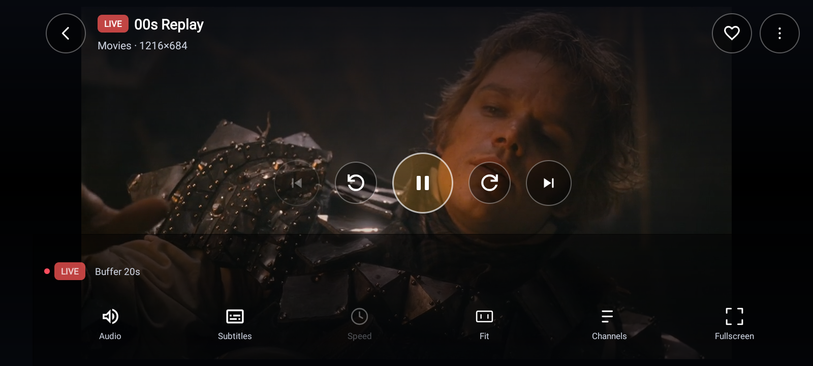
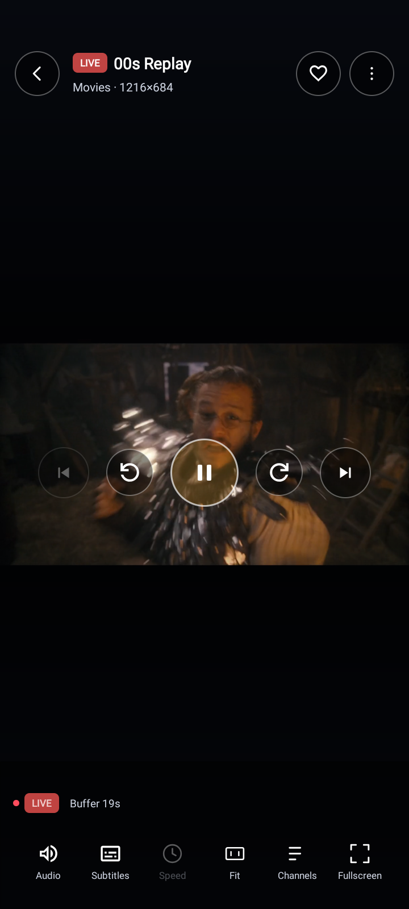
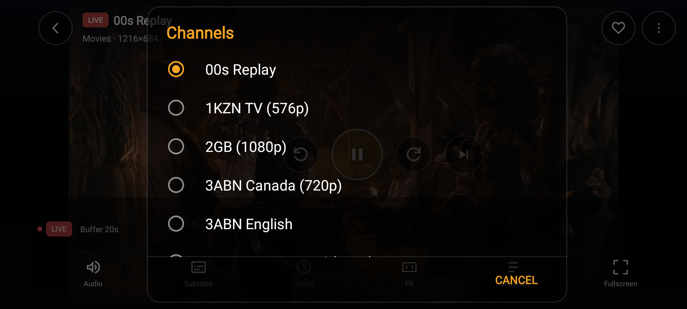
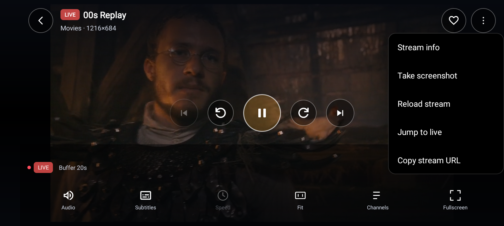
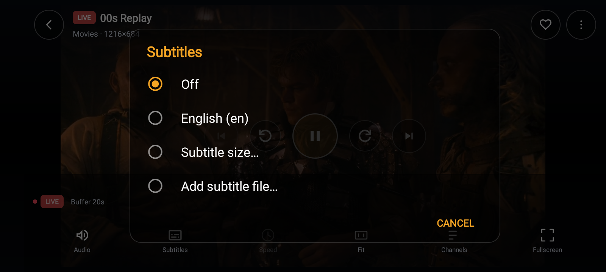
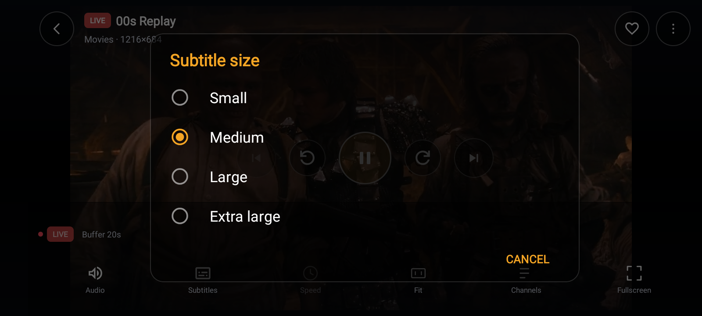
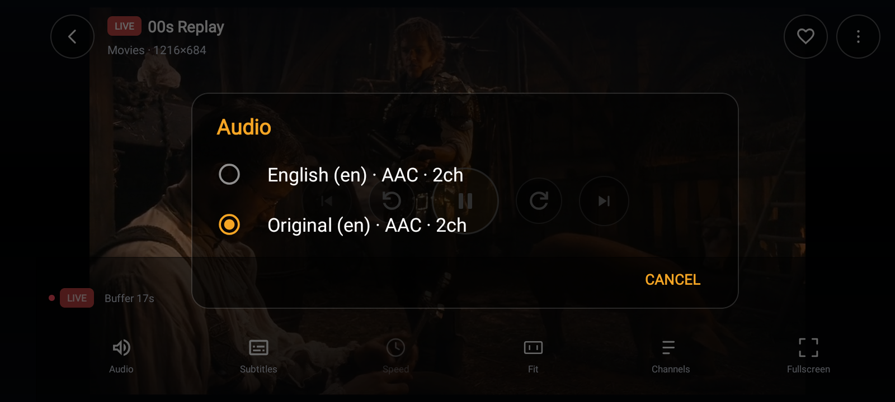

# MPV Android Engine

A reusable Java playback engine wrapping `libmpv` for Android. The host application owns the UI and video surface.

## Upstream Components

- **MPV core version:** `0.41.0-UNKNOWN`
- **MPV Android integration:** [mpv-android](https://github.com/mpv-android/mpv-android)
- **Integration release:** [2026-09-17](https://github.com/mpv-android/mpv-android/releases/tag/2026-09-17)
- **Integration commit:** `c2e02fe111541e4063ab8f868bf629649ed937a3`

The MPV core version is taken from the upstream Android build scripts at `buildscripts/deps/mpv/MPV_VERSION`.

See [LICENSING.md](docs/LICENSING.md) for licensing and redistribution information.


## Screenshots

### Video Player

<p align="center">
  
</p>

<p align="center">
  
</p>

### Features

<table>
  <tr>
    <td align="center">
      <br>
      <b>Playlist</b>
    </td>
    <td align="center">
      <br>
      <b>Player Menu</b>
    </td>
  </tr>
  <tr>
    <td align="center">
      <br>
      <b>Subtitles</b>
    </td>
    <td align="center">
      <br>
      <b>Subtitle Size</b>
    </td>
  </tr>
</table>

### Audio Player

<p align="center">
  
</p>


## 1. Requirements

- Android Studio and a compatible Android SDK.
- JDK version required by the project's Gradle configuration.
- Git.
- An Android device or emulator for testing.

## 2. Build the AAR

Clone the repository and enter the project directory:

```bash
git clone https://github.com/mr-bipolar/mpv-android-engine.git
cd mpv-engine
```

Build the release AAR:

```bash
./gradlew :mpvengine:clean :mpvengine:assembleRelease
```

On Windows, use:

```bat
gradlew.bat :mpvengine:clean :mpvengine:assembleRelease
```

After a successful build, the AAR is generated at:

```text
mpvengine/build/outputs/aar/mpvengine-release.aar
```

## 3. Add the AAR to an Android app

Copy `mpvengine-release.aar` into the host application's `app/libs/` directory:

```text
YourAndroidApp/
└── app/
    └── libs/
        └── mpvengine-release.aar
```

If the `libs` directory doesn't exist, create it.

## 4. Add the Gradle dependency

In the host application's `app/build.gradle`, add the following inside `dependencies`:

```groovy
implementation(files("libs/mpvengine-release.aar"))
```

Sync the project with Gradle.

Check the engine's Gradle configuration and README for any additional Android dependencies required by the host application.

## 5. Import the Java API

```java
import com.maxplayer.mpv.MpvPlayer;
import com.maxplayer.mpv.MpvPlayerConfig;
```

Create the player using the engine's public API:

```java
MpvPlayer player = MpvPlayer.create(
        getApplicationContext(),
        MpvPlayerConfig.defaults()
);
```

This initializes the player instance. The host application must still attach a video surface, configure playback, handle player events, and manage the lifecycle using the actual public API documented by the engine.

## 6. Native libraries and supported ABIs

The engine packages native libraries for:

- `arm64-v8a`
- `armeabi-v7a`
- `x86`
- `x86_64`

Ensure the target device's ABI is supported by the included native libraries.

## 7. Verify the build

Build the host application:

```bash
./gradlew assembleDebug
```

Test initialization and playback on a real Android device. Successful AAR compilation alone does not guarantee that every stream or device is supported.

## 8. Licensing

This engine includes MPV, FFmpeg, JNI glue, and other third-party components. Each component may have separate license and source-distribution requirements.

Read [`docs/LICENSING.md`](docs/LICENSING.md) before distributing the AAR or an application that includes it. Do not assume that all components are MIT-licensed.

## Documentation

See the `docs/` directory for integration, configuration, native build instructions, verification, limitations, and licensing information.

## Download the AAR

You can use the prebuilt Android library without building the engine yourself.

1. Open the repository's **[Releases](../../releases)** page.
2. Download `mpvengine-release.aar` from the latest release's **Assets** section.
3. Copy the downloaded AAR into your Android application's `app/libs/` directory.
4. Add the dependency to your app module's `build.gradle`:

   ```groovy
   dependencies {
       implementation(files("libs/mpvengine-release.aar"))
   }
   ```

5. Sync Gradle and build your application.

### Build from source instead

If you prefer to build the AAR yourself, follow the instructions in [Building the AAR](docs/BUILDING_NATIVE.md) and use the Gradle build configuration included in this repository.

### Compatibility and licensing

Check the release notes for the engine version, supported Android ABIs, and known limitations.

Review [`docs/LICENSING.md`](docs/LICENSING.md) before distributing the AAR or an application that includes it. The AAR contains native MPV/FFmpeg components that may have separate license and source-distribution requirements.


## API Reference

### Java Classes

| Class | Purpose |
|---|---|
| `MpvPlayer` | Main player lifecycle and playback API |
| `MpvPlayerConfig` | Player configuration and default settings |
| `MpvPlayerListener` | Playback events and error callbacks |
| `MPVLib` | Lower-level mpv native bridge |

### Player Lifecycle

Create the player using the configuration object:

```java
MpvPlayer player = MpvPlayer.create(
    context,
    MpvPlayerConfig.defaults()
);
```

Attach the rendering `Surface` through the API supported by
your `MpvPlayer` implementation. Keep the surface lifecycle
synchronized with the Android view lifecycle.

Release the player when it is no longer needed. Do not use
the player after it has been released.

### Configuration

Configuration support depends on the options exposed by
`MpvPlayerConfig` and the native libraries packaged with this
build.

Document the following categories when supported:

- Hardware video decoding
- Buffering and cache configuration
- Video scaling and aspect ratio
- Audio output and volume
- Subtitle configuration
- Network streaming and HTTP options
- Logging and diagnostic options

### Playback Properties

Document each property or getter exposed by the Java wrapper,
including its return type and whether it can be changed at runtime.

Potential mpv property categories include:

- Playback position and duration
- Pause and playback state
- Volume and mute
- Current audio, video, and subtitle tracks
- Video dimensions and aspect ratio
- Buffering and playback status

### Commands and Events

List the commands that the Java wrapper actually exposes.
For each command, document its parameters, return value, and
whether it is synchronous or asynchronous.

List listener callbacks separately, including playback start,
pause, completion, errors, and property changes where supported.

### Native Compatibility

The complete mpv manual is not a guarantee that every option,
property, or command is available in this Android build.
Support depends on the bundled libmpv version, build flags,
native dependencies, and wrapper implementation.


## MpvPlayer API Reference

`MpvPlayer` is the public, UI-independent Java facade for the bundled
libmpv playback engine. The host Android application owns the rendering
`Surface`, while `MpvPlayer` manages playback, playlists, tracks, buffering,
live-stream detection, retries, and video adjustments.

### 1. Create and Initialize

| Method | Description |
|---|---|
| `MpvPlayer.create(Context, MpvPlayerConfig)` | Creates a player using the native backend. Listener callbacks are dispatched on the main thread. |
| `initialize()` | Creates and initializes libmpv, applies configured options, and starts observing playback properties. |
| `release()` | Stops the engine, destroys native resources, and permanently releases this player instance. |
| `addListener(MpvPlayerListener)` | Registers a playback listener. Duplicate registrations are ignored. |
| `removeListener(MpvPlayerListener)` | Removes a previously registered listener. |
| `getConfig()` | Returns the configuration object used by this player. |

**Lifecycle:** Call `initialize()` before using playback controls. Call
`release()` when finished. A released instance cannot be reused.

The native glue currently supports only one player instance per process.
Create the player on a suitable application lifecycle boundary and avoid
creating multiple concurrent instances.

### 2. Surface Management

The application owns the `SurfaceView` and its rendering lifecycle.

| Method | Description |
|---|---|
| `getSurfaceCallback()` | Returns the cached `MpvSurfaceCallback` instance. |
| `bindSurface(SurfaceHolder)` | Registers the callback and attaches an existing valid surface if available. |
| `unbindSurface(SurfaceHolder)` | Removes the callback and detaches the surface. |
| `attachSurface(Surface)` | Attaches a surface to the native backend. |
| `detachSurface()` | Detaches the current rendering surface. |
| `setSurfaceSize(int width, int height)` | Updates mpv's Android surface dimensions. |

When using `SurfaceView`, prefer `bindSurface()` and `unbindSurface()` so
surface creation and destruction are handled consistently. A video load
may remain pending until a surface is attached when GPU video output is
enabled.

### 3. Load and Control Playback

| Method | Description |
|---|---|
| `load(String uri)` | Loads a URL, filesystem path, or supported content URI using default load options. |
| `load(String uri, LoadOptions options)` | Loads media with per-load settings such as headers, user agent, referrer, start position, and audio-only mode. |
| `reopen()` | Reopens the current source. For VOD, it attempts to resume from the last known position. |
| `play()` | Resumes playback, seeks to the beginning after completion, or attempts to reopen an errored/idle current source. |
| `pause()` | Pauses playback. |
| `togglePause()` | Toggles between paused and playing behavior. |
| `stop()` | Stops playback while retaining the playlist model. |
| `frameStep()` | Advances one frame. |
| `frameBackStep()` | Attempts to step back one frame; returns `false` when the source is not seekable. |
| `takeScreenshot(String absoluteFilePath, boolean includeSubtitles)` | Requests a screenshot to a file path, with or without subtitles. |

Example:

```java
MpvPlayer player = MpvPlayer.create(context, MpvPlayerConfig.defaults());
player.initialize();
player.load("https://example.com/video.m3u8");

// When finished:
player.release();
```

The example omits surface setup and error handling. For video output, attach
the host's valid surface before expecting video to render.

### 4. Seeking and Live Playback

| Method | Description |
|---|---|
| `seekTo(double seconds)` | Seeks to an absolute position in seconds. |
| `seekBy(double deltaSeconds)` | Seeks relative to the current position. |
| `seekToPercent(double percent)` | Seeks to a percentage from 0 to 100. |
| `jumpToLive()` | Seeks to the known live edge or reopens the stream when necessary. |
| `isSeekable()` | Returns whether the loaded media is reported as seekable. |
| `isLive()` | Returns `true` only when the live detector identifies or is explicitly told that the stream is live. |
| `getLiveStatus()` | Returns `LIVE`, `VOD`, or `UNKNOWN`. |
| `getLiveStatusReason()` | Returns the detector's explanation. |
| `getLiveEdgePositionSeconds()` | Returns the estimated buffered live edge, or `NaN` when unavailable. |
| `getLiveLatencySeconds()` | Estimates the distance between the playhead and the live edge, or `NaN`. |
| `isNetworkStream()` | Reads mpv's `demuxer-via-network` property. |

Seek methods return `false` when the player cannot seek. Live-edge and latency
values are estimates based on mpv's buffered timeline, not a broadcaster's
confirmed real-time timestamp.

### 5. Playlist Management

| Method | Description |
|---|---|
| `getPlaylist()` | Returns the wrapper's `PlaylistManager`. |
| `next()` | Advances to the next playlist entry; returns whether the operation succeeded. |
| `previous()` | Moves to the previous playlist entry; returns whether the operation succeeded. |
| `setAutoAdvance(boolean enabled)` | Enables or disables automatic advancement after an entry ends. Enabled by default. |
| `setSkipFailedEntries(boolean enabled)` | Allows moving to the next entry after retries are exhausted. Disabled by default. |

The wrapper manages the playlist model separately from mpv's native playlist.
The native player is used for the currently active entry.

### 6. Playback State and Media Information

| Method | Description |
|---|---|
| `getState()` | Returns the current `PlaybackState`. |
| `getLastError()` | Returns the latest retained `MpvError`, or `null`. |
| `getMediaInfo()` | Returns the loaded `MediaInfo`, or `null`. |
| `getPositionSeconds()` | Returns the current playback position, or `NaN`. |
| `getDurationSeconds()` | Returns the known duration, or `NaN`. |
| `getMediaTitle()` | Returns mpv's media title, if available. |
| `getMetadata()` | Returns metadata from the current media, or an empty map. |
| `getBufferedPositionSeconds()` | Returns mpv's demuxer-cache time, or `NaN`. |
| `getBufferingInfo()` | Returns a snapshot of buffering state and cache metrics. |
| `getVideoInfo()` | Returns video dimensions, aspect ratio, frame rate, and scaling information, or `null`. |
| `getStats()` | Returns playback and decoding statistics, or `null`. |

Possible playback states are determined by the `PlaybackState` enum and
include `IDLE`, `LOADING`, `PLAYING`, `PAUSED`, `BUFFERING`, `ENDED`,
`ERROR`, and `RELEASED`.

Some numeric getters use `NaN` or sentinel values when information is
unavailable. Check the corresponding model class before assuming a value
is valid.

### 7. Audio Controls

| Method | Description |
|---|---|
| `setVolume(int volume)` | Sets volume from 0 to the configured/runtime-reported maximum. |
| `getVolume()` | Returns the cached volume. |
| `setMuted(boolean muted)` | Enables or disables mute. |
| `isMuted()` | Returns the cached mute state. |
| `setSpeed(double speed)` | Sets playback speed from 0.01 to 100. |
| `getSpeed()` | Returns the cached playback speed. |
| `getAudioTracks()` | Returns a snapshot of audio tracks. |
| `selectAudioTrack(int trackId)` | Selects an audio track by ID. |
| `disableAudio()` | Disables audio track selection. |
| `addExternalAudio(String uri)` | Loads and selects an external audio source. |
| `setAudioDelay(double seconds)` | Sets audio delay from -60 to +60 seconds. |
| `getAudioDelay()` | Reads the current audio delay. |
| `getAudioDevices()` | Returns audio output devices reported by mpv. |
| `setAudioDevice(String deviceId)` | Selects a reported output device or `auto`. |

The exact audio device list depends on the active audio output and Android
device. Track IDs should come from the current track list.

### 8. Subtitle Controls

| Method | Description |
|---|---|
| `getSubtitleTracks()` | Returns a snapshot of subtitle tracks. |
| `selectSubtitleTrack(int trackId)` | Selects a subtitle track and makes subtitles visible. |
| `disableSubtitles()` | Disables the selected subtitle track. |
| `setSubtitlesVisible(boolean visible)` | Shows or hides the selected subtitles. |
| `areSubtitlesVisible()` | Returns the reported visibility state. |
| `loadExternalSubtitle(String uri)` | Loads and selects an external subtitle. |
| `setSubtitleDelay(double seconds)` | Sets subtitle delay from -3600 to +3600 seconds. |
| `setSubtitleSize(double size)` | Sets text subtitle size from 1 to 200. |
| `setSubtitleScale(double scale)` | Sets subtitle scaling from 0.1 to 10. |
| `setSubtitlePosition(int percentage)` | Sets subtitle vertical position within the reported allowed range. |

Subtitle support depends on the subtitle format, libass/FFmpeg build features,
and subtitle styling. ASS/SSA subtitle styles may not follow the text-size
setting in the same way as ordinary text subtitles.

### 9. Video Scaling and Geometry

| Method | Description |
|---|---|
| `setAspectRatio(double ratio)` | Sets a numeric display aspect ratio. |
| `setAspectRatio(String ratio)` | Accepts ratios such as `16:9`, `4:3`, `2.35:1`, or a decimal. |
| `resetAspectRatio()` | Restores the mpv build's default aspect override. |
| `setVideoScaleMode(VideoScaleMode mode)` | Sets the scaling mode. |
| `setZoom(double factor)` | Sets zoom from 0.25x to 8x. |
| `setPan(double x, double y)` | Adjusts horizontal and vertical pan fractions. |
| `setCrop(int x, int y, int width, int height)` | Applies a crop rectangle in source pixels. |
| `clearCrop()` | Clears the manual crop. |
| `setRotation(int degrees)` | Sets rotation to 0, 90, 180, or 270 degrees. |
| `resetVideoScaling()` | Resets aspect, scaling, zoom, pan, rotation, and crop settings. |

`VideoScaleMode` values are defined by the wrapper's enum. Scaling and zoom
behavior can vary with video output and hardware decoding configuration.

### 10. Advanced Playback Options

| Method | Description |
|---|---|
| `setDeinterlace(boolean enabled)` | Enables or disables deinterlacing. |
| `setHardwareDecoding(MpvPlayerConfig.HardwareDecoding mode)` | Changes the configured hardware decoding mode. |
| `isOptionSupported(String option)` | Checks whether mpv recognizes an option name through `option-info`. |
| `getOptionReport()` | Returns a snapshot of options rejected during initialization. |

A hardware-decoding change may take effect only when the next file is opened.
Call `reopen()` if you need to reapply it to the current source.

An option being recognized by mpv does not guarantee that its requested value
is accepted or that the corresponding feature works on every device.

### 11. Version and Diagnostics

| Method | Description |
|---|---|
| `getMpvVersion()` | Returns the loaded mpv version string. |
| `getFfmpegVersion()` | Returns the loaded FFmpeg version string. |
| `getOptionReport()` | Returns rejected initialization options and their error details. |

### 12. Threading and Callbacks

The default factory dispatches listener callbacks on Android's main thread.
The custom constructor accepts an `Executor` for callback delivery.

Playback callbacks may report state changes, position and duration updates,
buffering changes, media loading, track changes, live-status changes, video
information, retry scheduling, completion, errors, and native log messages.
See `MpvPlayerListener` for exact callback signatures.

Initialize and release the player once per instance. Keep Android surface
creation and destruction synchronized with the player lifecycle. Although
mpv's client API is thread-safe, applications should avoid racing lifecycle
operations against active playback calls.


## Copyright

Copyright © 2026 mr-bipolar.

This copyright notice applies to original project code only. MPV and other third-party components remain subject to their respective licenses.
